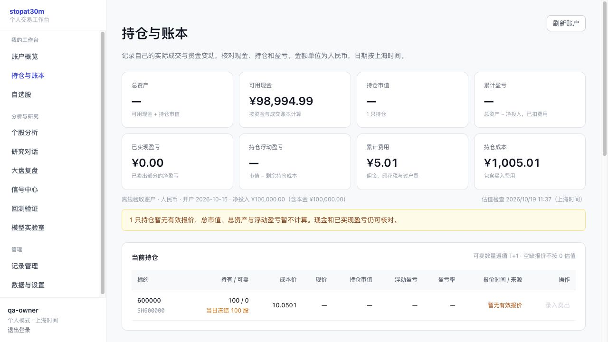
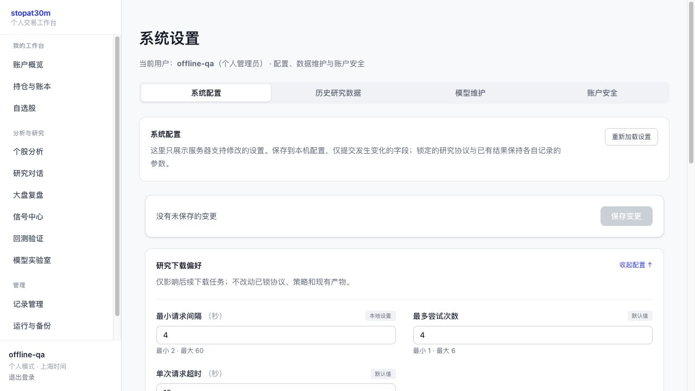
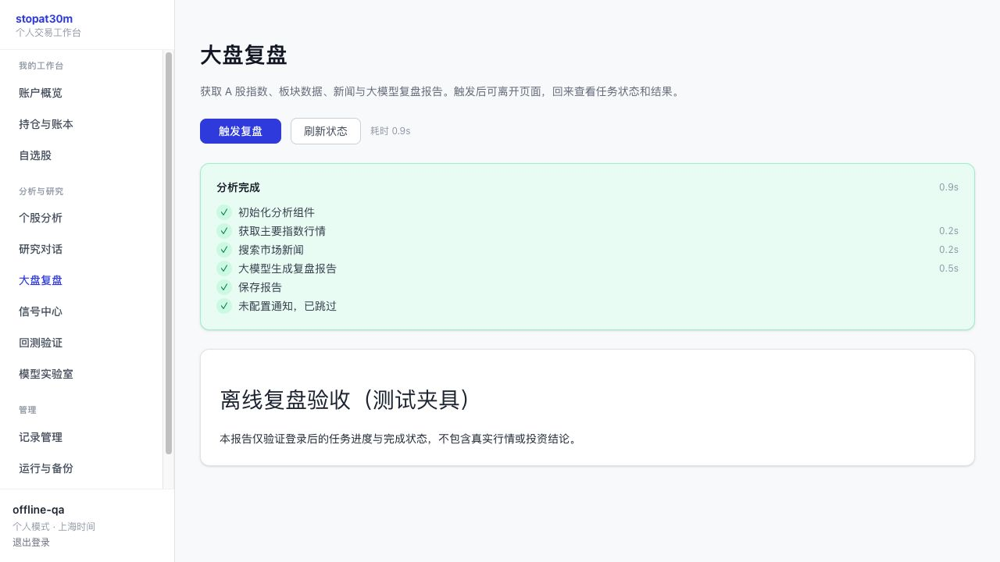
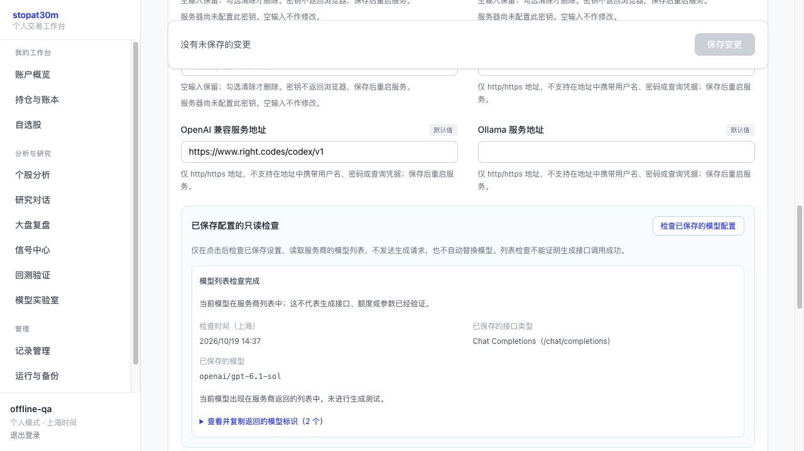

# StopAt30M 改进方案与实施记录

审查日期：2026-10-19。范围：当前仓库代码、配置、页面与离线可验证行为。没有使用真实资金、连接券商、部署阿里云或测得策略收益。

## 1. 产品定位与边界

把项目收敛为一个个人使用的 A 股研究与交易工作台：行情与数据检查 → 自选及研究 → 可复现回测 → 模拟验证 → 持仓、资金与成交复核。

默认只有一个本人使用的管理员账户，保留登录保护和数据归属；不为了个人使用增加组织、租户、付费或复杂角色体系。已有多用户数据不能自动合并，也不能把无归属的历史交易显示成每个人的资产。

第一阶段以手动成交记录、个人模拟账本、日线研究为核心。真实券商接入独立于研究模块，必须经过对账、交易规则和风险测试后单独实施；模型和大语言模型输出不直接产生实盘委托。

20% 暂按年化收益率研究目标理解。它不是软件验收承诺，也不是已有回测结果。先保证净值、费用、行情时间、撮合时序正确，再讨论策略收益。

## 2. 当前架构与判断

当前已有 React/Vite 前端、FastAPI、SQLite、Qlib 因子与模型、多个行情适配器、三套回测、CSV 手动账本及 JSON 模拟账户，功能覆盖面较大，但关键业务事实没有统一。

主要矛盾不是缺少更多指标或策略名字，而是同一份持仓、现金、价格和收益在不同入口有不同算法。现有代码适合作为原型继续演进，不适合在未经账务和回测校正的情况下据此进行实盘自动交易。

采用模块化单体即可，不引入微服务：

```text
React 个人工作台
    ↓ 认证 API、账户摘要、任务与研究结果
FastAPI
    ├─ 个人账户：账户、资金流水、成交、持仓推导与对账
    ├─ 数据服务：行情来源、逐证券缓存、日期、质量与降级状态
    ├─ 研究服务：因子 → 模型 → 信号 → 回测 → 实验记录
    └─ 后台任务：状态、进度、失败原因与重试
    ↓
SQLite（业务事实）+ 文件目录（行情、模型、研究产物）
```

SQLite WAL 和事务足够支撑单机个人账户。昂贵的训练和批量下载不应占用请求线程；业务状态和研究产物应有清晰边界。阿里云部署由使用者自行负责，本轮不修改服务器。

## 3. 已确认的问题与优先级

### P0：先修正确性和资金事实

1. **账户没有闭环。**`api/v1/endpoints/trading.py` 原来直接追加成交，不检查现金、超卖、可卖数量或重复请求；CSV、JSON、SQLite 各自记账。需要一个有初始资金、资金流和原子成交的账户服务，页面的现金与净值都由它计算。
2. **历史数据归属混乱。**持仓与交易查询混入 `user_id=NULL` 的旧记录。遗留数据必须显式标记、审核后导入，不能静默算入个人账户。
3. **报价失败变成资产归零。**缺失报价被当成 `0`，造成虚假的 -100% 浮亏。缺报价应是未知状态，持仓成本仍可见，市值/收益显示为未完整估值，且不能用于自动定仓。
4. **模拟成交不可靠。**新标的报价未保存，首次买入可能无法成交；同日手动结算可以释放当日买入量；买入费用未完整计入成本；已有账户可能被重新初始化覆盖。
5. **回测时序存在前视。**账户回测在开盘决策前用当日收盘价标记资产。只能使用决策时已经可知的信息，收盘估值放在成交之后。
6. **收益指标存在失真。**首日成本和收益被覆盖、组合与基准索引不一致、年化公式与实际净值增长不一致、回撤遗漏初始本金；观察天数被称为成交笔数。
7. **回测记录可被覆盖。**基础回测产物写固定目录，不同历史结果可能实际读取同一份最后生成的文件。每次运行必须有独立目录与配置快照。
8. **受 Git 跟踪的配置包含凭据。**审查确认原 `config.yaml` 有非空的 LLM API 密钥和行情 Token，不是明显占位文本。本轮将值移到 Git 已忽略的 `config.local.yaml`，公共配置清空，并补上本地覆盖加载与回归保护。历史提交和已有远端副本不因此消失，使用者需要到服务商轮换这些凭据；不在文档、日志或补丁说明中展示密钥。

### P1：数据与业务流程可靠

1. 行情缓存共用一个时间戳，刷新证券 B 会延长证券 A 的过期价格；改为逐证券时间、来源和有效性。
2. 本地 Qlib 收盘和网络即时报价没有区分；本地复权收盘不应伪装成最新可成交价格。
3. 日线接口只要返回非空就接受，缺少字段、日期排序、去重、价格/成交量合理性和落后日期检查。
4. 本地数据状态只检查目录存在，没有最新有效日期、有效证券覆盖、失败数量与数据缺口。
5. 调仓频率未被账户回测正确执行；部分策略选项没有真正执行其宣称的逻辑。未支持的策略应明确拒绝，不能输出挂着另一个策略名字的收益。
6. 快速回测基准参数未传入，表单显示的设置与实际计算不一致。
7. 长任务主要存在内存状态，服务重启后的恢复、每用户归属、取消与重复提交防护不足。
8. 生产 SPA 深层路由没有完整回退，刷新子页面会 404；未知 API 和丢失静态资源不能被错误回退成 HTML。
9. 单人使用还要经过邀请码流程；应提供清晰的首次创建管理员方式、默认关闭注册、保留密码保护。

### P2：研究质量和长期维护

1. `data/fetcher.py` 与 `data/fetcher/` 并存，接口与实现重复；逐步保留兼容入口、移除重复实现。
2. 依赖版本范围过宽，Python 的安装声明与运行依赖不一致；前端已有锁文件，应统一使用 `npm ci` 并补充构建和离线核心回归 CI。
3. 配置读写、API、任务、模型与执行边界不清；应把业务校验沉到服务层，避免 CLI、Web、回测各写一套规则。
4. 日志缺少关联任务、运行 ID、数据版本；应提供数据与账户备份、异常后恢复和运行状态。
5. 既有默认日期和股票池不能作为“最新可训练”的证明；应验证数据与分段日期，而不是自动把全历史都用来调参。

## 4. 持仓、资金与交易的目标口径

账户唯一事实来源是账户资金流和成交记录，持仓是可重建的结果，而不是可随意编辑的另一个余额。

- 一个个人账户明确记录初始资金、币种、创建时间。入金/出金独立记账，不冒充交易利润。
- 买入扣成交金额与全部费用；成本包含买入费用；卖出按移除的成本计算已实现损益，净收入扣卖出费用。
- 现金不能因为并发请求、滑点或重复提交变成负数。卖出不能超过真实持仓或可卖数量。
- 相同请求标识只能产生一次资金变化与一次成交；重试返回原结果。
- 普通 A 股当日买入不可立即卖出；真实成交的补录与委托申报规则应分开，科创板、创业板、北交所、ST、基金等规则不能一概套用普通主板参数。
- 减仓、止损和取消委托不能被“禁止新增风险”的熔断误伤。
- 总资产 = 现金 + 有效价格下的持仓市值；总损益应与已实现 + 未实现损益、净外部资金流保持可核对关系。
- 报价缺失、过期和来源降级要明确展示。部分证券缺报价时，不输出伪装完整的总资产或收益率。
- 旧 CSV/JSON/无归属流水保留，需迁移预览、校验和人工选择归属后才纳入新账户，不静默丢弃或猜测初始本金。

首批先把个人账户的账务与费用闭环做对；分红、配股、拆合股、融资融券、税费历史版本、券商流水导入与订单成交拆分列为后续账本能力。

## 5. 最新数据与质量管理

区分三类数据：盘中报价、已完成交易日的 OHLCV、研究用复权历史。获取时间不是行情发生时间，更不是本地历史数据的覆盖日期。

目标协议包含代码、交易所、数据时间、获取时间、来源、复权方式、成交量单位、状态与错误原因。

首批重点：

- 报价缓存按证券独立过期，拒绝非有限、非正价格。
- 不把后复权 Qlib 收盘回退为真实即时报价。
- 历史数据读取验证日期、OHLCV、排序与重复；请求的结束日与实际最后有效日期都保留。
- 数据状态显示可用性、水位、覆盖数量和警告，失败不能声称已更新。
- 下载与分析入口需要反馈实际成功/失败，已有多源回退策略继续复用。

后续：交易所交易日历、停牌/涨跌停状态、断点续传结果审计、按证券补齐缺口、盘后自动更新与告警、数据版本校验和。不把工作日直接等同于交易日。

特别需要后续解决的存量问题：当前股票池构建使用今天的成分回填整个历史，存在幸存者偏差；不同源的成交量可能分别用手/股；复权 OHLC 与真实整数股撮合混用。没有完成数据转换与版本迁移前，历史成交量和账户回测仍不能声称券商级复现。

## 6. 回测、观测与 20% 年化研究目标

### 统一回测结果

每份结果需要包含：运行 ID、策略/模型与参数、训练/验证/测试区间、数据来源/版本/股票池、信号时间、成交时间和价格、初始资金、佣金/税费/滑点、基准、净值与回撤、真实成交记录、成交失败原因。

必须展示净收益与基准，区分累计收益和年化收益；短样本的年化可能非常极端，不能当成长期收益能力。未知基准不能自动当作零收益。

首批修复已确认的公式、索引、时间顺序、调仓频率、价格表与结果目录错误，增加合成数据回归测试；真实历史数据尚未加载时不生成或展示“20% 已达标”结果。

### 研究验收设计

以下是研究筛选目标，不是预期一定实现的实盘承诺：

- 目标年化收益 20%，同时评估最大回撤、夏普、卡玛、换手、成交率与基准超额收益。
- 风险预算先采用配置中的最大回撤 15% 作为研究起点，实际阈值应由个人风险承受能力决定；不要通过增加杠杆或降低费用假设凑收益。
- 训练、验证、最终样本外测试严格按时间切分。最终测试集不能用于反复选参数；增加滚动样本外测试。
- 覆盖上涨、下跌、震荡与流动性紧张区间，检查子区间和行业集中度；尽可能使用多个完整市场阶段。
- 在合理佣金、印花税、滑点、停牌、涨跌停和 T+1 条件下评估；做成本与参数敏感性分析。
- 和简单的买入持有、指数基准及等权策略比较，确认改进来自可重复的超额收益。
- 固定模型/数据/参数后观察模拟盘一段时间，再研究实盘执行；保存失败实验，避免只保留最好的曲线。

普通账户回测、简化权重研究与信号质量评估应有不同名称和局限说明，不能把近似权重回测包装成可执行账户收益。

## 7. 前端与个人使用体验

首屏围绕“我的账户 → 数据是否可信 → 下一步操作”，保留市场指数与板块作为背景信息。

- 账户页显示现金、持仓市值、总资产、已实现/未实现损益、累计费用、可卖数量及报价状态。
- 统一人民币、小数位、千分位、百分比与 A 股红涨绿跌；未知值展示明确的不可估值状态。
- 成交表单支持日期、数量、价格、费用与备注；验证不能通过 `parseInt` 悄悄截断；提交后明确成功/失败并防重复。
- 账本提供分页与可核对的成交金额、费用、净资金变化，不只展示最近几笔。
- 数据缓存与更新失败显式区分，不用刷新请求时间冒充数据时间。
- 回测参数显示单位、有效范围和实际默认值，任务错误可见，完成后可定位对应结果。
- 侧栏按账户/研究/设置分组，适配小屏；技术路径和原始 JSON 放入可展开详情，主流程使用业务语言。
- 单人模式隐藏注册和多人管理入口，仍保留认证和首次管理员创建说明。

## 8. 实施批次与验收

### M1：本次先落实的可信工作台基础

计划先完成并用离线回归验证：

1. 个人账户、资金变动和成交校验服务，严格账户归属、幂等和完整费用核算；修复模拟经纪的明显错误。
2. 报价缓存与缺价处理、历史数据有效性、数据健康状态。
3. 回测公式、索引、开盘/收盘时序、调仓频率、策略参数诚实性、结果目录隔离。
4. 个人工作台与持仓/成交页面、回测关键反馈和一致的格式。
5. 默认个人使用的注册策略、生产 SPA 回退、最小测试和构建校验。

验收依据是代码、自动化离线测试、前端生产构建和可见页面。不会用模拟数据的演示收益证明策略能赚 20%。完成后在本节追加实际结果，未实施项明确保留。

### M2：数据与研究可信度补全

历史成分、复权/未复权双价格、公司行为、成交量单位迁移、真实交易日历、持久任务、实验元数据、滚动验证、回测结果比较、日度账户净值与收益归因。

验收：可从指定数据与策略版本重跑得到一致结果；数据更新时间与缺口可查询；不同来源的相同交易单位一致。

### M3：执行与长期运行

券商文件导入、账户对账、订单/部分成交/撤单生命周期、风险配置与审计、监控备份恢复；真实券商 API 在单独环境与人工开关后接入。

验收：同一订单重试不重复成交，断电恢复后账户可重建，券商与本地现金/证券差异可解释，禁止将研究或聊天输出直接当成下单权限。

## 9. 资料与规则依据

- [上交所交易规则（2026 年修订）](https://www.sse.com.cn/lawandrules/sselawsrules2025/fund/trading/c/c_20260424_10817739.shtml)：交易与交收约束、不同板块的申报数量不能简单统一。
- [财政部：关于减半征收证券交易印花税的公告](https://m.mof.gov.cn/czxw/202308/t20230827_3904226.htm)：自 2023-08-28 起的减半安排。跨历史区间的费用需要按生效日期配置，不能无条件回填今天的税率。
- [Qlib 组合策略与回测](https://qlib.readthedocs.io/en/stable/component/strategy.html)：基准、成本与组合风险评估。
- [Qlib 评估实现](https://github.com/microsoft/qlib/blob/main/qlib/contrib/evaluate.py)：应明确算术与几何收益口径，和本项目净值定义保持一致。

资料用于核对规则与方法，项目自身的具体结论来自上文列出的代码检查；未据此作出个股推荐。

## 10. 实施完成记录

本节记录本轮已经落实的范围，与后续 M2/M3 分开。当前未声称达到完整券商系统，也没有取得 20% 年化的实测证据。

### 已落实

- **账户：**新增独立的 SQLite 账户/资金流/成交表；以 Decimal 处理金额与剩余成本，事务锁后校验资金和股数，提交成功才返回成功回执。初始化防覆盖，入出金与成交支持幂等、顺序日期和个人归属。买入费用进入成本，卖出损益与现金闭环，未知/过期报价不计算完整资产与浮盈。
- **模拟账户：**新证券报价可用于首次买入；过期或旧文件无时点报价拒绝撮合；执行调仓计划时重新获取有源时间的实时行情，成交与风控共用该价格，保留源时间而不把计划价刷新成新报价；同日结算不会解除 T+1，后续报价/成交改变会替换同日快照；修复买费成本、重复委托、文件并发和初始化覆盖问题。风控熔断允许合法减仓。
- **行情与历史数据：**逐证券缓存时间；报价携带来源、行情时间、获取时间和有效性；不再把 Qlib 复权收盘冒充市价；日线验证排序、重复、有效 OHLCV 和日期。状态页读取真实本地结构与元数据，最大证券日期与可信水位分别展示，不宣称“目录存在就已最新”。
- **数据更新：**新增管理员手动历史更新与可查询的持久状态；单数据目录跨进程互斥，异常返回失败、进程中断可识别为 interrupted；没有在启动时自动下载全市场。沿用已有增量下载实现，任务结束后仍需核对覆盖范围。
- **回测：**修复开盘前视、初始净值/首个成交日费用、基准索引、几何年化、初始回撤和真实成交计数。基础引擎按份额/现金演算，处理持仓漂移、隔夜与日内复合、调仓费用和缺价失败。账户引擎按实际滑点费用验现金，执行调仓频率并跟踪每日风险高水位。拒单计入报告，日均换手包含未调仓日。
- **研究记录：**每次运行独立目录与来源配置；基准参数真正生效，默认值与支持方法由 API 提供；本轮明确仅支持 `top_k`，不支持的模式拒绝执行。报告带研究限制，未定义比率/缺失基准不伪造为 0 或极大值。CLI 和旧版 Streamlit 同样支持未定义指标，并能定位独立运行目录；样本不足不作综合评级。
- **页面：**账户概览、持仓/可卖、费用、出入金、分页账本、遗留参考；刷新和失败反馈、幂等重试、统一金额与上海日期。首页增加账户和数据检查；回测显示真实参数与限制、失败状态和完成后的结果定位；分组导航与小屏菜单，个人模式隐藏注册和多人管理。
- **运行基础：**普通页面深层路由回退到 index.html，缺失 API/资源仍返回 404；管理员 CLI 校验；默认关闭注册；配置按公共→本地→环境覆盖，原非空凭据已移至本地忽略文件。补充离线测试依赖，以及 [核心回归和前端构建 CI 模板](ci/core-checks.yml)。当前 GitHub CLI 授权有 `repo`，没有 `workflow`；为保持原有手动推送可用，模板先保留在文档目录，未自动启用 Actions。后续扩展授权后可移到 `.github/workflows/checks.yml`。

### 验证与实际范围

- 自动化离线回归：**90 tests passed，20 subtests passed**；Python 编译、依赖一致性与差异格式检查通过。现有 SQLAlchemy UTC 时间默认值及新版 Starlette 测试客户端有弃用提示，未影响这些测试通过，兼容性清理仍需后续处理。
- 离线测试覆盖：资金不足、超卖、T+1、手续费与部分卖出、幂等冲突、并发双花、数据库提交失败、遗留/账户隔离、未知与过期报价、首买和同日净值、缓存独立 TTL、旧计划/页面缓存不能续期撮合、价格索引、首日净值、调仓频率、基准缺失、拒单与风险峰值、CLI/旧页面未定义指标、SPA 和配置覆盖。
- 实际应用工厂集成：JWT 登录 → 建立账户 → 买入 → 同请求重放 → 持仓与现金 → 同日卖出拒绝 → 数据状态/回测默认接口，未调用真实券商。
- 2026-10-19 11:37 上海时间，通过腾讯免费单标的报价在线验证，响应包含行情来源、行情发生时间与独立获取时间；这不代表全市场历史已下载或所有提供商可用。
- 前端完整 ESLint 检查通过（0 错误、0 警告），生产构建通过。生产构建仍有较大 bundle 提示，拆包优化留后续，不影响此次构建成功。
- 浏览器验收使用 `/private/tmp` 的独立测试数据库、离线账户和禁用网络行情的夹具：登录、开户、买入、费用扣款、T+1、缺价状态、数据设置、页面刷新可用。下图全部是离线验收数据，不是用户真实账户或策略业绩。



### 明确保留的后续工作

1. 不自动迁移旧 CSV/JSON 的历史成本与 NAV，也不把旧记录直接计入新账户。迁移和历史校正仍须预览、对账与确认。
2. 历史指数成分、公司行为、未复权交易价格、跨源成交量单位、完整交易日历与品种规则尚未补全；现有账户回测仍是研究仿真，不能据此直接承诺实盘结果。
3. 研究/分析任务主要仍在内存中，重启不能续跑；数据更新的状态与互斥已持久化，但不是通用持久任务系统。自动日度更新、重试告警和更多提供商的真实联调继续 M2。
4. 尚未加载完整历史、训练或完成样本外策略验证。20% 年化目标未被验证，没有以调参、模拟数据或删除失败区间制造达标结论。
5. 暂未接真实券商，也没有对用户阿里云机器做部署。新数据更新与旧模拟账本锁当前针对 Linux/macOS 验证，Windows 支持仍需单独验证。
6. 旧提交可能已暴露的凭据需要使用者到服务商轮换。当前移出公共配置不清除旧 Git 历史或已发布副本。

## 11. 第二阶段实施与实源检查

2026-10-19 按数据、历史成分和样本外可信度继续实施。操作步骤、输入口径与命令见 [研究工作流](RESEARCH_WORKFLOW.md)。本阶段的代码完成状态与真实历史验证状态分别记录。

### 已实现的约束

- 历史股票池区分 `fixed/index_pit/snapshot`；PIT 区间保存公告与生效时间、退出公告证据、完整覆盖与成员数量口径。未知的未来退出不会提前删股。今天声明的 ETF 池明确披露回看选池限制。
- 旧 Qlib 下载器不再用今天的 CSI300/500 成分生成覆盖整个历史的区间；保留当前参考快照，已有历史文件不自动改写。
- 完整自然日交易所开市/休市标记、有限覆盖与可知性检查，移除工作日猜测；停牌不能变成市场休市。日内会话检查限定支持的年代与品种。
- 同源未复权/复权 OHLC、原始量额单位、逐日配对、缺口与复权异常筛查；内容地址、来源版本、文件哈希、刷新保留旧快照。BaoStock 分页兼容 pandas 2，旧下载器也修复原价日期错配和伪造 factor=1 的降级。
- 固定参数、固定池及数据声明先锁定，再读取行情；前日收盘信号、次日开盘调整、成本后净值，开发/验证/最终样本外分段不混用。最终观察块连续持仓、不重置本金；同成本等权/买入持有与价格指数分别比较。
- `research lock/prepare/inspect/run/plot/universe-import/universe-audit` 命令；独立结果、失败记录、代码/依赖/数据/协议校验和与可导出的净值回撤图。

### 真实数据检查与当前边界

少量真实联调已确认 BaoStock 能提供 ETF、指数与包含休市的日历，双价格快照在 2024-01-02 至 2024-01-10 的 SH510300/SH000300 小区间通过校验。这不是完整 OOS 结果。

2013—2025 全区间下载在 SH510500/SZ159915 请求后复权时发现大量响应仍标为未复权，严格校验已拒绝该数据；没有放松复权校验或计算并发布该批收益。证据和修正记录见 [数据质量事件](research/data_quality_incidents.json)。

东方财富同源双价格适配已实现并做离线响应校验；另锁数据声明，保持资产池、策略参数与分段不变，BaoStock 日历仍单独标明来源。替代来源的完整真实下载及最终 OOS 结果仍须通过联网与数据质量验收。

用户已明确授权继续联网。随后同一东方财富下载命令的自动审批服务仍连续超时，请求没有执行；此前也出现过审批容量不足。这个阻塞不是不安全判定，也不是策略回测失败。没有把未执行的请求登记为供应商无数据，更没有用合成收益替代最终结果。

本轮全套离线回归为 **173 tests passed、20 subtests passed**；Python 编译、差异格式和依赖一致性检查通过。绘图器仅用合成夹具验收过布局，不作为真实业绩附件发布。

当前尚无完整、精确生效的沪深300历史基线与调样日志，不声称历史指数成分已补齐；现有固定 ETF 研究与 PIT 导入审计也不能替代这些来源。公司行为现金/股数账本和历史原始数据版本仍未完整核验，研究数据继续标记 `execution_ready=false`，20% 年化未被验证。

### 东方财富默认来源与下载恢复补充

按用户选择，`research prepare` 默认使用东方财富协议。请求固定官方主机，串行间隔默认至少 2 秒；连接故障、408、429、5xx 有限退避，遵守 `Retry-After`，长冷却持久保存。403、重定向、错误字段或单位、无效价格直接停止。响应通过校验后才原子缓存，同日可续传；跨上海日期需明确刷新全部 raw/adjusted，不拼接不同采集批次。单缓存目录使用进程锁，缓存恢复保留原下载时间与校验和。本地批次仍不能证明供应商多次响应间从未修订复权数据。

本次补充后全套离线回归为 **200 tests passed、20 subtests passed**；Python 编译、差异格式及依赖一致性检查通过。新增覆盖含限流、冷却、恢复、缓存篡改、进程锁和合法三位小数价格的舍入误差。

东方财富单次连接探测已实际执行，结果为 `RemoteDisconnected`；没有 HTTP 状态码或 429，不能称为已确认限流。完整低频下载命令仍因自动审批服务容量错误而未执行；这个限制与供应商连接故障分别记录，未产生最终 OOS 收益。详情见 [数据质量事件](research/data_quality_incidents.json)。

## 12. 网页研究入口接线

2026-10-19 补齐获取完整行情前可以独立完成的网页工作：

- 「数据与设置」默认提供东方财富双价格研究下载、锁定区间与资产池、串行与重试设置、显式新采集批次、快照日期/覆盖和任务记录。旧 Qlib 更新折叠保留，两套入口明确区分；任务状态未确认时禁止重复提交。
- 「回测中心」默认进入「样本外研究」，选择注册协议与匹配快照启动研究；锁定参数只读，不再要求先提供模型或预测文件。没有有效匹配数据时禁用运行。
- 通过 `research` 管理员 API 读取默认目录中的 CLI/网页研究产物。逐项校验数据来源、输入/输出哈希、协议与路径；坏文件保留并显示不可用，不混入正常结果。旧 BaoStock 协议和已有结果只读，网页新运行使用东方财富协议。
- 下载与研究任务共用操作系统非阻塞锁，JSON 原子保存进度和真实失败；刷新页面可查询，已失去运行锁的残留任务标记中断，不自动重发网络请求。
- 结果页展示含初始净值 1 的四组净值/回撤、开发/验证/最终样本外指标、连续观察块、分页成交/持仓/信号及来源清单。虚拟敞口单位和人民币账户资产明确区分。

本轮不发起新的外部行情下载，不创建真实账户或默认密码。测试产生的价格和收益只保存在隔离临时目录，未放入用户真实研究列表。当前仍没有通过完整实源验收的最终 OOS 业绩。

验收：全套离线 **212 tests passed、20 subtests passed**；新增研究工作区、异步任务/中断恢复、损坏记录隔离、产物来源/校验和、CLI 结果发现、分页与真实 JWT 管理员访问测试。Python 编译、差异格式、依赖一致性、前端完整 ESLint 和生产构建通过。使用真实应用工厂与已构建前端进行隔离联调，登录/设置/回测路由、两项静态资源、研究协议及空目录返回正确。现有依赖弃用和 bundle 大小提示保留为后续维护项。

浏览器可视检查被自动审批服务以容量不足拒绝执行；本次没有宣称完成浏览器视觉验收。启动命令与网页路径见 [研究工作流](RESEARCH_WORKFLOW.md#在网页操作)，当前本地尚无管理员，需使用交互式 `user create-admin` 自行设置用户名和密码。

## 13. 网页配置与日常账户操作

2026-10-19 继续按个人使用补齐配置、账户观测和运行维护。第 12 节记录的是上一轮状态；本轮已能启动隔离服务，并完成真实浏览器操作验收。

### 本轮已落实

- **网页首次设置：**个人模式空数据库在本机 localhost 页面创建管理员，自行输入用户名与密码；同源、直连本机校验及数据库写锁防止远程初始化和重复创建。首次设置同时生成并持久保存登录签名。已有账户直接登录，远程部署保留管理员 CLI 作为初始化入口。
- **配置中心：**研究下载偏好、传统回测、信号诊断、账户回测及模拟风控分组编辑；AI 服务配置现已移至独立的「模型配置」页面，见第 16 节。只开放实际支持的字段，校验类型、范围和相互关系；只提交变更项，保存到被 Git 忽略的本地配置，不覆盖公共配置或其他本地字段。采用进程锁、原子写入和版本冲突检测。
- **凭据与审计：**密钥只显示是否已配置，留空保留，明确勾选后才能清除；环境变量覆盖项只读。配置文件权限为 `0600`；审计只保存时间、操作者和字段名，不保存值。页面显示生效范围与需要重启的项目，配置保存不会修改既有研究协议或结果。
- **网页研究：**下载表单读取配置中心保存的请求间隔、重试和超时默认值；单次任务可以临时调整，不自动改写全局偏好。研究数据、模型维护、账户安全各自有独立页签。
- **账户估值：**保存当前上海日期的账户观察估值，留存报价来源及时间、现金、持仓、账本版本和幂等回执；同日更新保留版本号，重放原请求返回原回执。持仓缺少有效新鲜报价时拒绝保存完整估值，等待行情期间若账本变化也拒绝保存旧版本。没有持仓的纯现金账户无需联网。
- **只读对账：**支持粘贴标准持仓 CSV 或本地读取文本，独立填写券商现金和数据日期；展示证券数量及现金差异。重复证券、无效代码或金额、超限文件会拒绝。核对不导入成交、不修改账户；相等不代表成本、费用或公司行为已经正确。
- **运行与备份：**管理员页面检查数据库、个人账本、持久登录签名、完整研究快照、模型组件与备份状态。使用 SQLite 一致性备份接口，包含已提交的 WAL；原子发布并核对 ZIP、数据库校验和。导出的是全库，包含用户密码哈希、账本、估值和库内分析聊天记录；不包含本地配置、行情、模型或研究文件。损坏备份单独显示，不提供直接覆盖当前数据库的网页恢复。
- **页面收尾：**配置分组默认仅展开研究偏好，保存栏置顶，技术字段收进高级详情；持仓表优先于估值/对账区域。系统设置、持仓与账本、运行与备份均可通过导航进入。

### 验收

全套离线回归 **293 tests passed、20 subtests passed**，前端完整 ESLint、TypeScript 和生产构建通过。新增测试覆盖首次设置并发与来源限制、签名持久化、敏感输入不回显、配置原子失败与版本冲突、环境变量保护、估值版本及报价时点、只读对账、备份 WAL/哈希/权限和完整接口流程。现有依赖弃用与 bundle 大小提示仍保留。

隔离浏览器验收使用临时配置、数据库、研究目录及备份目录，不触碰用户真实账户：首次设置页面 → 登录 → 修改研究间隔并保存 → 刷新后仍保留 → 研究下载读取新默认值 → 建立纯现金测试账本 → 保存当日估值 → 显示持仓数量差异 → 创建并显示校验通过的备份。没有请求外部行情或产生真实券商交易。



### 距离完整交易系统仍需补齐

1. **实源数据与研究验收：**获取通过双价格、交易日历、单位和覆盖校验的完整历史快照，按已锁协议完成真实样本外与成本敏感性检查。当前没有最终 OOS 业绩，20% 年化仍是待验证目标。
2. **历史与公司行为：**取得完整历史指数成分基线和调样证据，补齐分红、送转、拆并股的现金/数量事件及历史版本核验；现有结构和导入校验不等于来源已齐全。
3. **账户收益口径：**当前保存的是观察时刻资产及累计盈亏金额，不是完整收盘 NAV，也没有把含入出金的资产变化冒充收益率。正式 TWR/XIRR、历史补录重算、收益归因需在日度估值和资金流覆盖可靠后继续实现。
4. **券商与执行：**目前是实际成交记账和标准 CSV 只读核对。券商专属交割单预览导入、差异处理、公司行为入账、订单/部分成交/撤单生命周期及真实接口需独立验收。
5. **长期运行：**增加备份恢复预演、定时收盘更新、持久任务重启续作、失败通知和前瞻模拟盘；先明确恢复与执行边界，再开放自动化。当前运行检查只检查本机状态，不代表外部服务已连通。

当前启动与网页入口见 [README 个人工作台](../README.md#个人工作台)。本轮不部署到阿里云，不自动提交或推送工作区改动。

## 14. 大盘复盘认证与运行依赖修复

2026-10-19 根据网页实际报错修复两项遗漏：复盘 SSE 进度请求此前没有携带 Bearer，因此被已启用的登录校验返回 401；本地环境只装过研究/测试依赖，缺少通知报告模块导入所需的 `markdown2`。没有通过关闭认证来解决进度连接。

- 进度流使用当前登录凭据；HTTP 鉴权错误、断线、无效响应与任务自身失败分别显示，可重新读取状态。初始化前失败及没有步骤的任务也能显示错误，状态未知时禁止重复提交。
- 后台在锁内预留运行状态并绑定具体任务对象，避免线程尚未启动时被重复触发。初始化步骤在依赖导入之前记录；上游错误使用固定提示，不把异常中的凭据或响应原文回显给页面。
- 上游服务 401 明确提示核对模型服务密钥和地址，与网站登录失效分开；当前入口为侧栏「模型配置」。未配置通知、通知未确认成功如实显示，报告已生成时保留报告。
- 新增 `requirements-web.txt`，覆盖网页、行情、AI、Markdown 报告依赖，不要求安装模型训练组件；补齐包安装清单中的对应依赖，已安装到当前项目 `.venv`。运行准备检查增加复盘组件缺失项。

验收：完整离线 **308 tests passed、20 subtests passed**，新增真实 JWT/SSE 边界、过期及禁用用户、并发提交、初始化依赖失败、上游 401、通知跳过/失败和线程启动失败恢复测试。前端检查、生产构建、9 项模拟进度流检查通过；真实依赖导入和 Markdown 表格转换通过。浏览器在隔离测试库上验证「登录 → 触发 → 实时步骤 → 完成」，使用明确标注的离线报告，不访问真实行情、调用付费模型或发送通知。



## 15. 搜索可用性与模型服务实源诊断

2026-10-19 继续根据真实运行日志处理搜索依赖、公共搜索拒绝和模型 `NotFoundError`。本次不将所有 404 简单归因于接口协议。

- **实源结论：**当前服务的 `/models` 返回 200，但没有配置中的 `gpt-5.4`；两个生成端点的空请求均返回参数错误，不能据此断言只支持 Responses。使用列表中的 `gpt-6.1-sol` 经 Chat Completions 执行一次最多 32 输出 token 的合成短请求，返回 200 和 `OK`。已审计保存本地模型为 `openai/gpt-6.1-sol`，协议保留 `chat_completions`。这次短测不包含用户账户或真实市场资料，也不等于完整复盘、新闻质量或策略业绩已验证。
- **网页诊断：**独立「模型配置」页面提供显式协议和管理员只读模型列表检查。仅点击后发出 GET `/models`；不生成、不自动换模型、不回显密钥。HTTP 401/403/404、超时、非 JSON、超大响应均有明确结果；按完整合法列表判断当前模型，再限制展示长度。编辑 AI 草稿、保存或重新加载会取消并清除旧检查结果。
- **传输：**文本分析和研究对话共享逐次请求参数，移除配置写入进程环境的副作用。高优先级环境配置、现有服务别名、本地配置有明确优先级，凭据与基础地址不在服务之间混接。Responses 使用 LiteLLM 的兼容桥保留文本与工具调用结构，不通过全局开关改变其他请求；协议差异依据 [OpenAI 官方迁移说明](https://developers.openai.com/api/docs/guides/migrate-to-responses)。
- **搜索：**补装 SerpAPI/Tavily SDK；缺 SDK 的服务不会进入轮询。网页支持现有搜索密钥、自建 SearXNG 地址和实际消费的新闻时间窗口。公共发现默认关闭，单次只使用固定实例；拒绝、验证页、限流或故障进入冷却，不轮换实例或跟随重定向绕过限制。博查余额不足属于服务商额度问题，程序不自动充值或假装搜索成功。
- **信息可信度：**移除搜索日志中的密钥片段、上游 HTML 与原始响应；剩余公共搜索凭据已迁入被 Git 忽略的本地配置。搜索无结果的上下文、生成提示词和最终报告明确说明缺少可核实新闻，不得编造来源，也不把缺失证据说成没有风险。

验收：全套离线 **398 tests passed、20 subtests passed**，Python 编译、依赖一致性、差异检查、前端完整 ESLint 与生产构建通过。覆盖搜索冷却/单实例、配置密钥/地址边界与重建搜索服务、模型列表权限与大小/截断/凭据过滤、请求参数优先级、无进程环境污染、404 安全回执及缺新闻披露。另用已安装 LiteLLM 在禁用 socket 的独立进程中验证 Responses 桥接及工具调用结构。真实联网范围仅上述有限模型诊断和短请求；网页按钮以无真实凭据的隔离夹具验收，未发送通知或执行券商操作。



## 16. 按服务商配置 AI 模型

侧栏「模型配置」（`/model-settings`）提供 OpenAI / 兼容服务、Claude、DeepSeek、Gemini、Ollama 和 AIHubMix 下拉选项，显示已配置、未配置与当前启用状态；选中后只展示该服务商字段。系统设置保留入口，量化模型维护只处理 Qlib 数据与模型，避免混淆。

「仅保存连接配置」保存所选服务商的密钥和地址，不切换当前模型；「保存并使用」切换服务商与模型。其他服务商的凭据保留，密钥不回显、空输入保留、显式清除才删除，环境变量覆盖字段只读。保存时校验服务商与模型前缀，Responses 仅允许 OpenAI 兼容服务；已有 `auto` 配置继续按原模型标识识别。

验收：全套离线 **478 tests passed、20 subtests passed**，前端 ESLint 与生产构建通过。隔离浏览器确认选择 Claude 并仅保存连接后，OpenAI 的启用状态、模型和密钥均保持不变；这些配置状态不代表已验证生成能力。

## 17. ETF 工程验证的历史记录（已转向第 18 节个股研究）

2026-10-19 按“数据、持仓与回测可信度优先”推进，本轮没有新增页面。实施与运行命令见 [研究工作流](RESEARCH_WORKFLOW.md#2026-10-19统一增量数据固定模型对照和前瞻记录)。

- **主数据与增量：**三只 ETF 的腾讯原价/HFQ 历史基座与近期整批采集，经重叠区间 2,160 个数值精确核对后组成新主版，截止 2026-10-16。原快照与响应保留，逐证券水位、共同完整日期、采集批次和原始取数时间均可追溯。日更只抓近期窗口，发现历史修订或双价格不齐就停止，不直接覆盖旧版本。本机 Qlib 历史目录实际不存在，本轮未混接 Qlib 归档。
- **历史模型对照：**2014—2018 训练、2019—2020 验证、2021—2025 历史样本外；固定 13 个特征和一套 LightGBM 参数，20 交易日标签按实际退出日清除跨边界样本，不调参、不早停。动量、LightGBM、同成本等权和买入持有共用核算，保留每边 5/10/20bp 全部情形。已用真实历史数据跑完，结果不支持 20% 年化目标。
- **收益口径约束：**腾讯 ETF HFQ 经发行人材料核对为累计现金分红仿射序列，不能直接作为可投资总回报。这轮价格研究主结果中 LightGBM 年化约 3.99%、最大回撤约 -41.15%，动量年化约 -6.81%、最大回撤约 -59.21%；这些数值不能据此认定模型可盈利。公司行为与原价加现金/份额核算仍要补齐。
- **最新候选重训：**另用统一主版训练 9,093 条成熟样本，最新训练信号为 2026-09-09，最后标签退出日为 2026-10-16。保持原特征、参数、费用；旧模型与旧结果不变。新模型使用过原测试时期，只允许未来验证，明确没有新的历史样本外业绩；活动期间固定模型，重训生成新版本。
- **持续记录：**新候选曾建立独立前瞻期间，动量与 LightGBM 各 100,000 元研究资金，保存真实冻结时间、数据/模型哈希、扣费净值、回撤和失败回执。首次更新因 159915 当日复权数据未发布被拒绝，尚无前瞻信号和收益；不能用旧数据补造。转向第 18 节个股目标后，本机工作日 16:15/16:45/17:15 的 ETF 专属任务已停止并移除注册，定义备份与原记录保留。它仍是日线研究敞口，不是券商下单或整数份额实盘。

该 ETF 方案是当时的工程范围，不是用户要求的 A 股个股最终范围。后续主线以第 18 节为准，保留这次研究的来源、结论及限制，不把 ETF 成绩改称个股成绩。

本轮最终完整后端回归 **634 tests passed、20 subtests passed**，依赖一致性检查通过。原价/HFQ 数据和研究结果保存在被忽略的 output 目录；可复核摘要见 [本轮结果记录](research/m3_20261019_summary.json)。

## 18. A 股个股：Qlib 历史基座、严格增量及重新训练

根据用户明确的个股目标，停止 ETF 自动任务，建立独立的 `output/research/ashare/` 研究链。步骤、来源、实际下载范围和命令见 [个股工作流](RESEARCH_WORKFLOW.md#当前主线a-股个股与-qlib-历史基座)。没有新增页面或接入真实券商。

- **真实历史基座：**固定社区 `investment_data` 2026-10-18 版，实际下载约 542MiB，保存原归档、上游提交和 SHA-256。审计 6,169 个证券目录、2000-01-04 至 2026-10-16 的历史日历与逐证券覆盖；不是 Microsoft 官方数据或保证完整的全 A 股 PIT 数据。历史沪深300在实验区间涉及 760 只个股。
- **真实最新个股数据：**实际取得当前 300 只下载目标的 BaoStock raw/HFQ 双价格，串行限速、保留原响应与批次。严格审计 264 只通过、36 只不通过；不放宽容差。通过部分只推进有效数据，失败部分保持原版，按数据审计选择同一来源的整段历史重建。SH601059 停牌/有限价格截止早于最新日，不能用日历或 factor 尾部冒充最新行情。
- **安全版本：**新增 Qlib 归档安全解包、文件清单/校验和、逐字段覆盖、不可变父子快照、接缝审计、显式部分发表及整证券重建。旧 `download --source qlib/qlib+baostock` 的盲目下载拼接入口已拒绝，避免复权尺度和单位混接。
- **实际训练：**已安装并使用真实 Qlib 0.9.7、官方 Alpha158 与固定 LightGBM，在 2012—2022 年训练 774,968 条样本；2023—2024 验证，2025—2026-10-16 留作历史样本外。六个未来交易日标签清除、训练期拟合预处理、原生模型/预处理状态/预测文件均保存。无 OOS 参数寻优或早停。新版本数据不覆盖旧模型结果。
- **回测可信度：**三种策略共用下一开盘执行、五日调仓、买入 5.1bp/卖出 10.1bp 假设成本。源数据缺失行情但保留 factor 的正常签名已经核实；部分字段损坏仍拒绝。海通证券与中国重工两项真实停牌、退市及换股已按官方公告的当时可知时点处理，按原始股数比率转换，保留独立证据和换股账本。原模型、预测与失败尝试均保留，未改参数、OOS 起点或缺价阈值。

**实源历史样本外已完成：**2025-01-02 至 2026-10-16，共 431 个交易日。LightGBM 扣假设费用年化 **15.79%**、最大回撤 **-14.17%**；固定动量年化 **13.03%**、回撤 **-41.40%**；历史成员等权年化 **5.24%**、回撤 **-13.45%**。模型尚未达到 20% 年化目标；这些仍是分数研究仓位的历史结果，不是可执行的实盘承诺。等权有 165 个陈旧估值日，动量 15 日，LightGBM 0 日，不能忽略基准持仓的冻结权益与估值限制。详见 [A1 结果与哈希](research/a1_20261019_summary.json)。

A1阶段当时的36只完整历史重建被两项真实源问题阻断：SH688223 IPO首日HFQ混标、SH601727原价第4,000行后分页截断而HFQ还有338行。当时的失败记录与严格通过的264只版本保留。后续A2已解决并另存完整36只重建版本，见下节；不能将这些A1阶段状态当作最新数据水位。

完整后端回归 **758 tests passed、20 subtests passed**，依赖一致性及差异检查通过，真实 Qlib 原生训练和公告事件时序均已核验。没有前端改动。原 PDF 未落盘，事件哈希明确绑定官方 web 提取记录，而非未下载的 PDF。

A1结束时个股每日自动运行尚未启用。后续执行核算、验证和前瞻启用状态以第19节为准；不能使用过测试期的数据重训后继续声称原时期仍是新OOS。20%年化仍是目标。

## 19. A2：原价整数股账本与前瞻执行

36只股票的整段数据修复、当日真实300成分补齐以及涨跌停、整手、T+1、最低佣金与权益核算已实现。原价历史对照、真实候选重训和原生每日任务按验证门禁推进，详见 [A2执行验证与运行记录](A2_EXECUTION_VALIDATION.md)。不新增页面或接入真实券商，不将A1分数仓位结果改称本阶段整数股收益。

## 20. A3/A4：成本诊断、历史验证及范围收敛

截至2026年10月20日，成本和模型诊断见[A3记录](A3_PROFIT_DIAGNOSTICS.md)，2023—2024年原始执行及税费证据已补齐并按先冻结的门槛完成12组验证，见[A4结果与决定](A4_HISTORICAL_VALIDATION.md)。推荐候选M1_E2在2024年净总收益41.67%、最大回撤7.31%，但2023年亏损4.38%，不据此宣称稳定达到20%年收益。2024用于候选选择，2025—2026此前已查看；活动模拟盘保留原基线和实际观察成交，新候选须另行前瞻冻结。

研究范围收敛为沪深300和中证1000。已核对截至10月19日的官方当前1,300只成员，并用发行人代码变更公告修复中证1000历史重复身份；2022年12月30日至2024年末485个交易日均闭合为300＋1,000，历史去重共1,743只。范围和入口约束见[范围说明](ASHARE_SCOPE.md)，具体数据来源状态见[数据来源说明](ASHARE_DATA_SOURCES.md)。这些股票池核验不代表中证1000原始交易状态、公司行为或收益已验证，现有收益仅为沪深300子集。

接下来的重点是中证1000独立市场证据和模型验证、同风险及全收益市场基准，以及新候选的连续前瞻模拟；继续围绕扣费收益、回撤和稳健性，不增加展示页面或自动真实券商交易。

## 21. A5—A8：完整股票池、低换手与模型期限验证

沪深300／中证1000历史联合范围、独立交易状态与公司行为审计、原价含费账本已推进至[完整稳定性结果](A5_STABILITY_RESULTS_20261020.md)。[A6固定预测实验](A6_LGB_TURNOVER_RESULTS_20261020.md)隔离了低换手执行的影响，[A7](A7_MODEL_HORIZON_AND_EXCHANGE_20261020.md)完成待换股公告核查和同样本预测期限诊断；条件换股参考价值不替代正式收益。

2026-10-20完成[A8真实H5／H20配对训练及含费对照](A8_SHARED_PANEL_HORIZON_RESULTS_20261020.md)：共同21交易日成熟样本、相同Alpha158特征和处理器，4次固定原生拟合、6条完整账本，先精确复现3条旧基线。有效连续账户中H5扣费累计+11.42%、最大回撤17.01%，H20为+4.76%、21.43%，H20换手更高。另有H5独立2026账户因200股信达证券待换股权益无正式标价而无效；保留失败，不截断或伪造现金回收。

本轮不支持推广20日模型，也没有推广新H5、改变活动模拟盘或下单。后续优先完成换股权益时钟核算、同风险全收益基准及冻结策略的新未来验证，不继续用已经看过的年份扩大调参。上述累计收益不是年化收益，尚无稳定年化20%的证据。

## 22. A9：先运行低换手前瞻观察

按后续明确选择，暂缓信达换股核算，另建[A9每日低换手模拟账户](A9_DAILY_LOW_TURNOVER_PAPER.md)。旧25笔模拟成交完整封存、旧定时任务停用；新期10万元空仓起步，复用A5原H5模型和处理器，固定A6持有10交易日／每5日检查／最多2只退出意图。没有将A8新H5、H20或旧无效收益导入新账户。

补齐两指数1300只固定来源观察池的独立增量链、来源回显校验和同日断点续采，执行使用新的实际冻结信号和当前观测报价。日报重点记录扣费净值、保守回撤、实际费用／滑点／换手／拒单和20／60实际交易日稳定性；不足样本或不完整估值明确标记，不提前年化。运行、首次信号及调度验收状态以A9文档为准。

## 23. A10：减少持仓数量的离线含费对照

2026-10-21按用户要求完成[A10持仓数量对照](A10_POSITION_COUNT_COMPARISON_20261021.md)。先声明20／15／10／5只、同一10万元和三条历史窗口，只改变目标持仓数，固定原A5年度H5预测、保留前40、持有10交易日、每5日检查与最多2只退出意图。三条20只基线核心摘要、最终状态和13类账本精确复现后，完成其余9条真实历史账本，没有重训、再生成预测或扩大网格。

12条路径11条有效，连续20只账户的原信达权益缺口继续无效。2025有效账户中，20只净收益6.93%、最大回撤5.75%、累计换手4.52倍、费用加滑点2449.06元；5只分别为-8.72%、15.75%、14.67倍和4776.28元。佣金仅节省182.75元，更大的实际成交金额带来更高滑点与卖出税费。5只2026部分年度收益虽更高，回撤与集中风险也上升，不能据此改盘。

正式联合门槛因连续基线无效而无法判定，没有合格推广候选；有效独立年度仍支持暂不直接减少持仓。当前20只前瞻模型、参数、资金、账本与定时任务均保持不变。保留独立源和执行审核、逐笔现金与费用核账、完整图表和机器摘要；全库2125项测试及20项子测试通过，1项跳过，另11项绘图测试通过。后续观察按原20／60完整收盘节点继续，若再研究成本，应另行预先声明成交金额或比例限制，不把本轮旧年份对照称为新的未来样本外证据。

## 24. A11：按资金比例限制换仓

按用户要求先冻结[A11设计及结果](A11_CAPITAL_TURNOVER_COMPARISON_20261021.md)，新增每次调仓买卖分别不超过前收盘净值5%／7.5%／10%的独立金额预算；首个计划建仓批次仅豁免一次，其余原20只目标、hold10_cap2、模型、费用与数据均不变。只缩减原候选数量、允许合法部分卖出、保留真实残仓计时，拒单与整手剩余额度不再分配，不新增选股或持仓硬上限。三条原基线完整精确复现后才运行九条候选，共12条账本全部保存。

2025三组均降低实际换手、交易成本和回撤，但净收益由原6.93%分别降到4.16%／5.77%／5.70%。7.5%组在有效2026部分年度净收益2.37%、回撤10.65%、费用加滑点1382.95元，优于原1.84%／13.43%／1739.64元，但平均非现金资产占比（1−现金/账面净值）从85.63%降至73.41%，超过事前暴露减少5个百分点的限制，不能称为同风险执行alpha。10%组资金投入接近原基线，却在两个独立年度都降低净收益。

10条路径有效；原基线连续账户和5%组独立2026账户因信达待换股权益无正式标价而无效，未修复、删日或补造现金。正式联合门槛无法通过，也没有有效独立年度同时满足所有预定改善条件。当前20只模拟盘、原模型、账本和调度保持不变，继续原20／60完整收盘观察；没有推广资金限制方案、重训或追加参数网格。全库2308项测试通过、1项跳过、20项子测试通过；原件、每批金额审计、独立审核与全部图表由机器摘要绑定。

## 25. A12：相近证券资金投入的含费对照

按用户要求完成[A12三组固定对照](A12_EXPOSURE_MATCHING_COMPARISON_20261021.md)。六条原策略／7.5%路径完整复现后，新增三个原策略＋每日现金调节账户：只读取参考账户前一个实际收盘的已知证券资金占比，固定1个百分点不交易区间、现有证券同比例合法整手调整、一次执行、不再分配拒单余量。核心与调节订单分开真实支付费用，模型、股票池、数据、原核心规则和活动账户均不变；没有事后扩网格。

两个独立年度均通过事前资金匹配门槛，平均绝对偏差0.533／0.413个百分点，覆盖241／243及189／189日。相近投入下7.5%收益5.77%／2.37%，匹配组3.80%／−0.84%；回撤4.77%／10.65%对5.20%／13.10%，成本1918.60／1382.95元对3830.90／3127.43元。每日调节额外240／236笔均触发最低5元佣金，实际费用＋滑点1496.29／1454.06元；复制低仓位没有复制7.5%的收益，但这不是纯现金与纯换仓因果分解。2025的7.5%仍低于原策略6.93%，不能据此推广。

九条完整账本七条有效，连续原基线和匹配组均因信达待换股权益无标价而无效；连续风险已知仅411／432日，不作三方收益归因。当前20只前瞻账户、定时任务和冻结模型继续不变，不自动使用资金上限或现金调节，不重训或重置本金。全库2573项测试通过、1项跳过、20项子测试通过，另20项新绘图测试通过；完整原件、来源／执行及独立核账、匹配质量、分目的成本与图表由机器摘要绑定。这些旧历史窗口不是新的未来样本外业绩。
